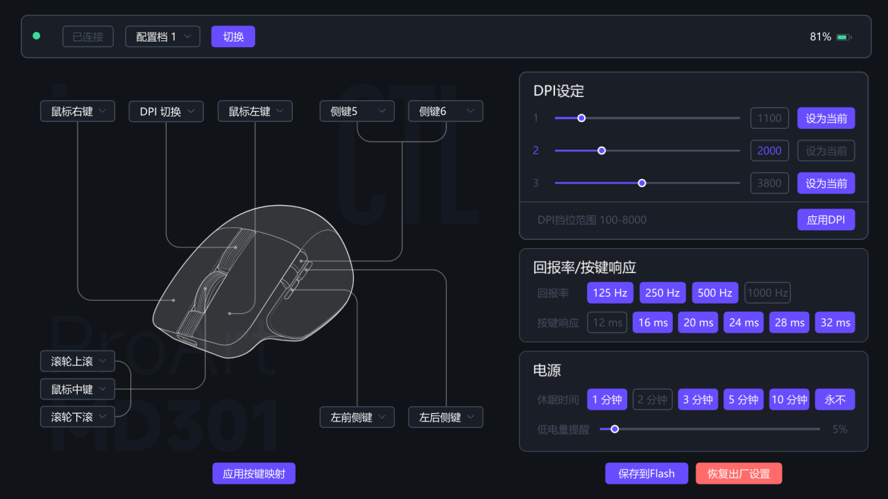

# md301ctl 的 Qt 前端（实验性）

用 **PySide6 + QML** 写的界面壳，替换原来那个零依赖 Win32 GUI 的观感。
目标是在不重写协议的前提下，把界面做成可以照设计稿（FigCraft 原型）复刻的样子。

## 设计原则

1. **协议只有一份实现。** 所有读写都走既有的 Rust 程序 `md301ctl.exe`，
   本目录只负责调用、解析 `--json`、把结果画出来。前端里**没有任何 HID 报文**。
2. **安全规则不重写。** 射频休眠守门、只在值变化时写入、范围校验，都在 Rust 侧；
   Qt 这层只做三件事：启动/刷新**只读**、开下拉**不写**、值没变**不写**。
3. **颜色/间距只有一个出处。** 全部在 `qml/theme/Theme.qml`；照原型换 UI 时先换它。
4. **不猜契约。** 选项列表（DPI 范围、回报率档位、按键响应档位、156 个功能码、
   按键名）全部来自 `md301ctl spec --json`。

## 前置

- Windows，Python 3.11（`uv venv` 或 `python -m venv` 都行）
- `PySide6-Essentials`（见 `requirements.txt`）
- 已构建的 `md301ctl.exe`：放在 `../target/release/`、或本目录、或桌面，
  或用环境变量 `MD301CTL` 指定绝对路径

## 运行

```bat
run.bat            :: 首次会自动建 .venv 并装依赖，然后起界面
```

或者手动：

```bash
uv venv --python 3.11 .venv
uv pip install --python .venv/Scripts/python.exe -r requirements.txt
.venv/Scripts/python.exe app.py
```

自检（**只读**，不写设备，可反复跑）：

```bash
.venv/Scripts/python.exe smoke.py
```

想看前端到底发了哪些命令（排查用）：

```bash
MD301_DEBUG=1 .venv/Scripts/python.exe app.py     # 每条命令打进 stderr
```

## 文件

| 文件 | 作用 |
| --- | --- |
| `app.py` | 入口：QML 引擎、中文默认字体、Fusion 样式 + 暗色调色板兜底 |
| `backend.py` | 后端桥：QProcess 串行执行 CLI、解析 JSON、属性/槽给 QML；含启动失败上报与 20s 看门狗 |
| `qml/Main.qml` | 主面板：设备状态 / DPI / 回报率·按键响应 / 按键映射 / 配置档 |
| `qml/theme/Theme.qml` | 设计 token（颜色、圆角、间距、字号）——**照原型改这里** |
| `qml/components/` | `Card`、`PillButton`、`StyledSlider`、`DarkCombo`（默认 Fusion 是白底，必须自己着色） |
| `smoke.py` | 无头自检：验证「界面桥 → CLI → 设备」这条链 |

## 数据契约（前端只依赖这两个命令）

```bash
md301ctl spec --json     # 静态规格，启动取一次，不碰设备
# { "caps": {...}, "sleep_times": [...], "buttons": [{name, code}...], "functions": [{code,label}...] }

md301ctl status --json   # 实时快照，一次调用一个对象
# { "device": {...}, "power": {...}, "dpi": {...}, "perf": {...},
#   "buttons": { "左键":496, ..., "向左滚动":494, "向右滚动":495 } }   ← 10 个槽位
```
`buttons` 里的 10 个槽位 = 基础表 8 个 + 扩展表里侧边滚轮的左右（协议里的 `sideKey5/6`，
偏移 16/18）。扩展表读不到时这两个键给 `null`，界面显示 `—`，不影响其余八项。

写操作分别是 `dpi set <档> <值>`、`dpi switch <档>`、`perf polling <hz>`、
`perf response <0-5>`、`buttons map <按键名> <功能码>`、`profile set <档>`、
`perf save`、`profile reset-all --yes`。



## 界面结构（按设计稿还原）

设计稿（1280×720 画布）拆成两层：

| 层 | 内容 | 位置 |
|---|---|---|
| 静态层 | 卡片底、鼠标插画、引线、水印、面板标题、行标签 | `assets/ui-bg.svg` + `assets/ui-bg.png`（2x） |
| 动态层 | 所有会随设备状态变化的东西：胶囊、滑条、数值、指示灯、下拉箭头、按钮 | `qml/Main.qml` 按坐标绝对摆放 |

坐标表在 `qml/proto.js`（10 个映射胶囊、三张卡片的行/胶囊/按钮坐标都从设计稿量出来的）。
颜色/圆角/字号全部集中在 `qml/theme/Theme.qml`。

### 换一份设计稿 / 重新生成背景层

```bash
# 1) 从设计稿 SVG 删掉「由 QML 负责画」的元素，得到静态背景层
python scripts/extract_proto.py /path/to/prototype.svg assets/ui-bg.svg
# 2) 渲染成 2x PNG（QML 里用 Image.Stretch 铺满 1280×720）
python ../AppData/Local/hermes/cache/scratch/render_svg.py assets/ui-bg.svg assets/ui-bg.png 2560 1440
```

三个必须注意的坑（都踩过）：

1. **别让两边都画同一个东西**：设计稿里画了胶囊/手柄，QML 又画一遍 → 重影。
   `extract_proto.py` 的 `SHAPE_DROP` / `LINE_DROP` / `TEXT_DROP` 就是干这个的。
2. **SVG 的 `<text y>` 是基线，Qt 的 `Text.y` 是顶边**，换算要减 12–15px，否则文字会骑在卡片分隔线上。
3. **槽位名要对上**：设计稿写「DPI切换」，CLI 的槽位名是「DPI 切换键」——
   `Main.qml` 的 `comboPos()` 忽略空格匹配，避免落到兜底坐标。

### 怎么让它变成"你的设计"

1. **导出设计**：SVG（**文字保留**，不用转曲；要原样嵌入的素材才转曲）+ 同尺寸 2x PNG；
2. **换 token**：颜色/圆角/字号 → `qml/theme/Theme.qml`；
3. **重排布局**：改 `qml/proto.js` 坐标或 `qml/Main.qml`；
4. **自检 + 截图对照**：`smoke.py` 保证链路没坏，截图和原型逐屏比对。

字体：设计稿用 **思源黑体 Medium**（`SourceHanSansCN-Medium`），本机没装思源，
`Theme.font` 回退到 **微软雅黑**（字宽接近，布局不变）。要完全一致就把思源字体配上或改这一行。
另外 SVG 里的 `<filter>`（投影/发光）Qt 会**静默忽略**，需要的话得在 QML 里用
`MultiEffect`/`DropShadow` 补。

## 自动刷新（唤醒后界面会自己恢复）

界面不会一直傻读设备，分两档，且只在需要时读：

| 情况 | 行为 | 实测耗时 |
|---|---|---|
| 读到正常值 | 每 **10 秒** 一次 `status --json`，**静默**执行（不刷状态栏、按钮不变灰） | 1–2 秒/次 |
| 读不到（鼠标射频休眠 / 接收器拔了） | 每 **1.5 秒** 一次 `info` 轻探针 | 0.17 秒/次 |
| 探针成功（设备醒了 / 插回来了） | **立刻**自动做一次完整刷新，回到 10 秒档 | 唤醒后约 2–3 秒界面自动恢复 |

要点：

- 轮询**只读不写**，不会碰设备设置；设备仍按它自己的休眠计时睡觉（无软件唤醒命令，只能动鼠标）。
- 读数正常时用 `status`，休眠时改用 `info`——因为休眠时 `status` 要 3.0 秒（里面是多次子读取），`info` 只要 0.17 秒。
- 自动轮询**不会覆盖界面草稿**：草稿与设备值比对，谁被改了谁的草稿就保留（拖到一半的滑块、没点「应用」的改动不会被冲掉）。
- 自动刷新**始终开启**（界面上没有开关）；上一次命令没跑完时这次轮询直接跳过，不排队堆积。
- 读数成功不往状态栏写字（顶栏只报「已连接 / 未连接」）；底部那行只在写操作成功或出错时出现，8 秒后自动淡出。

## 电源（休眠 / 低电量）

- **休眠时间**：6 档，取自官方 `SleepTime` 表——1 / 2 / 3 / 5 / 10 分钟与**永不**（值 255）。
- **低电量提醒**：0–100%、步进 5（官方接口校验范围就是 0–100）。
- 点档位 / 松开滑块即写入；`power set` 是**读-改-写**，只改你动的那个字段。
- 改动只在点「保存到 Flash」后断电保持（和官方页面一致）。
- **低电量提醒是怎么提醒的（实测）**：低于阈值时**鼠标本体红灯闪烁一阵后熄灭**，纯固件行为，与主机/网页无关。
  主机侧读不到任何"已提醒"状态位（把阈值设成 10% 与 65% 两个状态各读一次，解析字段除阈值本身完全一致），
  所以 Gear Link 与本工具都不会弹通知（官方 FAQ 也写明「設置通知」不在 Gear Link 支持范围内）。
  想做主机端提醒，只能自己用「电量 < 阈值」判断。

## 已验证（真机 ASUS ProArt MD301）

- `smoke.py` 通过：读到固件 0.0.41、电量、DPI 三档、回报率、按键映射、156 个功能码；
- 界面启动与刷新**不发任何写命令**（`MD301_DEBUG=1` 日志可证）；
- 合成鼠标点击「应用 DPI」→ 日志出现 `dpi set 1/2/3` + 一次 `status` 刷新，
  设备值未被改动（写的是原值）；
- 设备射频休眠时，状态栏显示 CLI 报的原话（如「设备处于射频休眠…」），值不会被覆盖。

## 打包成单文件 exe（给不装 Python 的人用）

```bash
uv pip install --python .venv/Scripts/python.exe pyinstaller
.venv/Scripts/pyinstaller.exe --noconfirm --onefile --windowed --name md301ctl-qt \
  --add-data 'qml;qml' \
  --add-data 'assets;assets' \
  --icon assets/logo.ico \
  --add-binary '../target/release/md301ctl.exe;.' \
  --collect-data PySide6 \
  app.py
```

要点：

- `--add-data 'qml;qml'` 必须加，否则运行时找不到 QML；
- `--add-binary '...;.'` 把 Rust CLI 打进包里，`backend.py` 会优先用 `sys._MEIPASS`
  里那份，所以拷到任何机器上都能独立跑；
- 产物 `dist/md301ctl-qt.exe` 约 81 MB（Qt 运行时 + QML 模块占绝大部分），
  **首次启动约 8 秒**（单文件模式每次启动都要把包解到临时目录）；想要秒开就改成
  `--onedir`（启动 1–2 秒，但产物是一个文件夹）；
- 检查包里确实带着后端和 QML：
  `.venv/Scripts/pyi-archive_viewer.exe -l dist/md301ctl-qt.exe | grep -E 'md301ctl.exe|Main.qml'`；
- 未做代码签名，Windows 可能提示 SmartScreen（"更多信息 → 仍要运行"）。

## Logo / 图标

- `assets/logo.svg` 是**用户提供的应用图标**，由它生成：
  - `assets/logo.ico` —— 7 种尺寸（16/24/32/48/64/128/256），用于窗口图标与打包进 exe；
  - `assets/logo-256.png` —— 单张 256px，用作兜底。
- 重新生成（改了 SVG 之后）：
  `scripts/gen_assets.py assets/logo.svg assets/logo-256.png assets/logo.ico`
  （脚本在仓库根的 `scripts/`，用 QtSvg 渲染，ICO 容器自己拼，不需要 Pillow）
- 图标只用在**窗口/任务栏图标**与 exe 内嵌图标上；标题栏里不再显示 logo
  （曾经放过白色圆角徽章，截图不好看，已按要求去掉）。
- **许可边界**：`assets/` 下的图标为用户提供，不在本项目 MIT 许可范围内；
  ProArt / ASUS 等名称与标识的权利归其所有者。

## 已知限制

- 一条 `status --json` 约 0.7–2 秒（设备 RF 链路本身慢），所以刷新时状态栏会短暂显示「读取中…」；
- 只做了主面板，没有做设置向导、按键宏、灯光等（这些官方页面也没有）；
- 用 PyInstaller 打成单个 exe 未做（要带 Qt 运行时，体积会大不少）。
